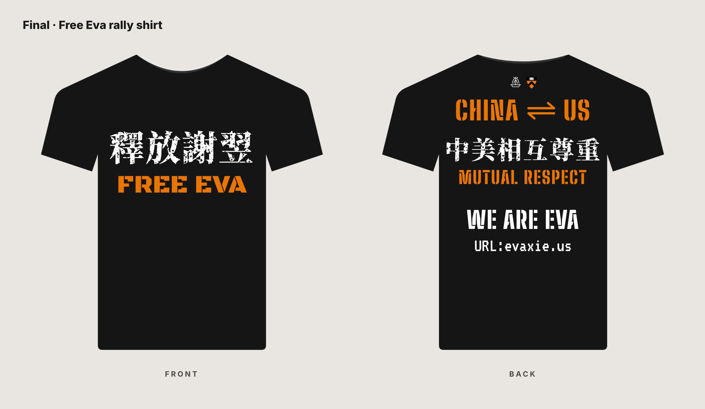

# Free Eva rally T-shirt

Graphics brought over from the "Free Eva Rally T-Shirt Concepts" design canvas (Eva Yi Xie rally shirt chat).

## Final design

- **Front:** 釋放謝翌 (traditional characters, worn white print) over **FREE EVA** in orange stencil.
- **Back:** fountain + Princeton shield icons, **CHINA ⇄ US**, 中美相互尊重, **MUTUAL RESPECT**, **WE ARE EVA**, `URL:evaxie.us`.
- Shirt color: black (#151515). Accent: Princeton orange (#E77500). White text.
- Fonts (Google Fonts): Black Ops One, Big Shoulders Stencil Display, Noto Serif TC, VT323.

## Folders

| Folder | What's in it |
| --- | --- |
| `final/` | The chosen design (front + back mockup) |
| `1-round1-concepts/` | First five concepts |
| `2-merged-mockups/` | Nine merged bilingual mockups |
| `3-dateless-qr/` | Round 3: dateless designs with QR placeholder, plus domain options |
| `4-script-comparison/` | Simplified vs traditional character styles, URL treatments |
| `assets/` | Princeton shield image and the worn-print texture mask |
| `source/design-files/` | Original `.dc.html` design files and `canvas.json` index from the canvas |
| `source/standalone-html/` | Same designs as plain HTML you can open in a browser (fonts load from Google Fonts) |

PNGs are 2480×1440 (2× the 1240×720 mockup boards). They are mockups, not print-ready separations; for printing, export the artwork from the standalone HTML at the printer's required size.
